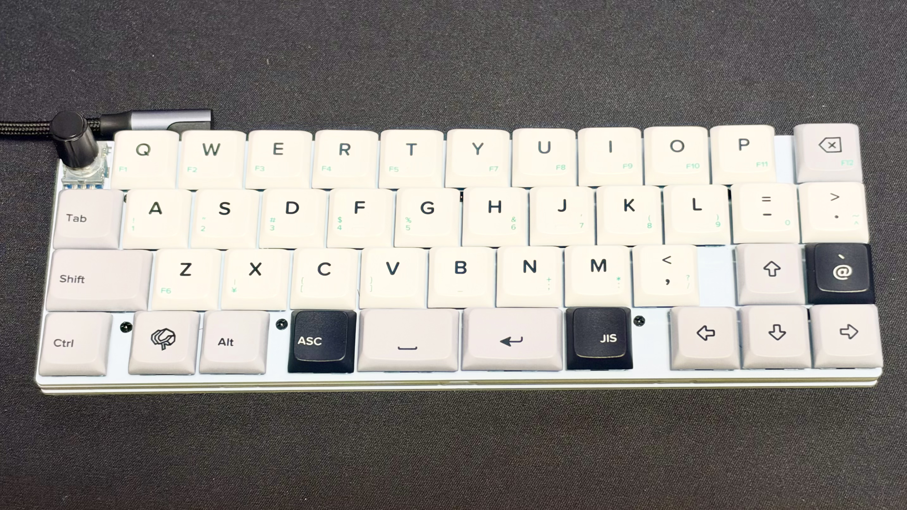

# ogm9-Izanami

RP2040 を基板に直接実装した、44キー + ロータリーエンコーダーの一体型キーボードです。

最初は [Auto-Keyboard-Design-Kit (auto-kdk)](https://sekigon-gonnoc.github.io/auto-kdk/) で生成したデータから始めましたが、
その後 EasyEDA 上でカスタムを重ね、現在の基板は auto-kdk の出力とは別物になっています。

## Preview

## Specs

| 項目 | 内容 |
|---|---|
| キー数 | 44キー + ロータリーエンコーダー 1個（プッシュスイッチ付き） |
| スイッチ | Kailh Choc V2（ホットスワップソケット） |
| MCU | RP2040（基板直付け） |
| フラッシュ | W25Q16JVSSIQ（16Mbit） |
| 接続 | USB Type-C（有線） |
| マトリクス | 4行 × 11列（COL2ROW） |
| 基板サイズ | 約 229.8 mm × 76.1 mm |
| 取り付け穴 | φ2.2 mm × 8（M2） |
| ファームウェア | QMK / Vial |

## Parts List

### キット外で用意するもの

| Part | Quantity |
|---|---|
| Choc V2 スイッチ | 44 |
| キーキャップ（Choc用） | 44 |
| ロータリーエンコーダー用ノブ | 1 |
| USB Type-C ケーブル | 1 |
| M2 ネジ・スペーサー | 8 |

### 基板実装部品

| Ref | Part | Package | LCSC | Quantity |
|---|---|---|---|---|
| U1 | RP2040 | LQFN-56 (7×7mm) | C2040 | 1 |
| U2 | W25Q16JVSSIQ（QSPI Flash） | SOIC-8 | C82317 | 1 |
| LDO1 | ME6211C33M5G-N（3.3V LDO） | SOT-23-5 | C82942 | 1 |
| X1 | 12MHz 水晶 X322512MSB4SI | 3225 | C9002 | 1 |
| USBC1 | TYPE-C-31-M-12 | SMD | C165948 | 1 |
| U5 | EC12 ロータリーエンコーダー EC121701J2A-HAL-047 | THT 5P | - | 1 |
| - | Choc ホットスワップソケット CPG135001S30 | SMD | C5333465 | 44 |
| - | ダイオード 1N4148W | SOD-123 | C81598 | 44 |
| R1, R2 | 27Ω | 0603 | - | 2 |
| R3, R4 | 5.1kΩ（CC プルダウン） | 0603 | - | 2 |
| R5, R6 | 10kΩ（Flash CS / RUN プルアップ） | 0603 | - | 2 |
| R7 | 1kΩ（BOOT 用） | 0603 | - | 1 |
| C1, C2 | 22pF | 0603 | - | 2 |
| C3–C10 | 0.1µF | 0603 | - | 8 |

## Pin Assignment

| 機能 | GPIO |
|---|---|
| ROW0–ROW3 | GP14, GP16, GP17, GP22 |
| COL0–COL5 | GP0, GP1, GP2, GP3, GP4, GP5 |
| COL6–COL10 | GP8, GP9, GP10, GP11, GP12 |
| エンコーダー A / B | GP27 / GP28 |
| エンコーダー プッシュ | GP29（ダイレクトピン） |

## 書き込み方法

1. 基板上の BOOT パッド（2つ並んだスルーホール）をピンセット等でショートしたまま USB ケーブルを接続します。
2. `RPI-RP2` ドライブとしてマウントされたら、ファームウェア（`.uf2`）をドラッグ＆ドロップします。

ファームウェア書き込み後は Bootmagic（マトリクス [0,0] のキーを押しながら接続）でもブートローダーに入れます。

## Firmware

- QMK / Vial 用のファイルは [qmk_firmware/keyboards/ogm9_izanami](qmk_firmware/keyboards/ogm9_izanami) にあります。
- push するたびに GitHub Actions（`.github/workflows/build.yml`、`target.json`）で `ogm9_izanami_vial` の `.uf2` がビルドされます。

## Files

| パス | 内容 |
|---|---|
| `pcb/ogm9-Izanami-pcb.json` | 現在の基板データ（EasyEDA Standard ソース） |
| `case/` | ケース（トップ・ボトム）STL |
| `foam/` | ケースフォーム SVG |
| `keycap/` | キーキャップ配色データ（yuzu） |
| `images/` | 画像 |
| `ogm9-Izanami.json` | 初期に auto-kdk で作成したレイアウトデータ（参考用。現在の基板とは一致しません） |

## Credits

- 初期設計: [Auto-Keyboard-Design-Kit](https://sekigon-gonnoc.github.io/auto-kdk/) by sekigon-gonnoc
- ビルドワークフロー: [vial-keymap-c-editor](https://github.com/sekigon-gonnoc/vial-keymap-c-editor)
